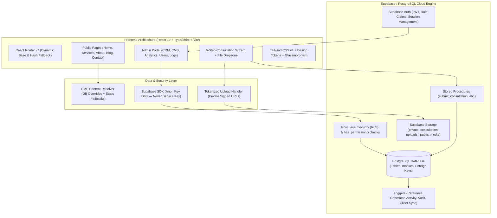

# TV Clarity Capital (Pvt) Ltd — Enterprise Web Platform & CRM

<div align="center">


### **"Our Capital is Your Success"**
**Professional Solutions for Finance, Business & Technology**

[](https://react.dev/)
[](https://www.typescriptlang.org/)
[](https://vitejs.dev/)
[](https://tailwindcss.com/)
[](https://supabase.com/)
[](LICENSE)

[Live Demo](http://localhost:5173/) • [Consultation Portal](http://localhost:5173/consultation) • [Admin Suite](http://localhost:5173/admin)

</div>

---

## 📑 Table of Contents

- [Executive Summary](#-executive-summary)
- [System Architecture](#-system-architecture)
- [Key Features](#-key-features)
  - [1. Client-Facing Public Platform](#1-client-facing-public-platform)
  - [2. Interactive Multi-Step Consultation Engine](#2-interactive-multi-step-consultation-engine)
  - [3. Executive Admin Portal & CRM](#3-executive-admin-portal--crm)
  - [4. Dynamic Headless CMS](#4-dynamic-headless-cms)
  - [5. Enterprise RBAC & Security](#5-enterprise-rbac--security)
- [Technology Stack](#-technology-stack)
- [Project Directory Structure](#-project-directory-structure)
- [Getting Started](#-getting-started)
  - [Prerequisites](#prerequisites)
  - [Installation](#installation)
  - [Environment Variables](#environment-variables)
  - [Local Development](#local-development)
- [Supabase Backend Setup](#-supabase-backend-setup)
  - [Database Schema & Policies](#database-schema--policies)
  - [Storage Buckets Configuration](#storage-buckets-configuration)
  - [Super Admin Onboarding](#super-admin-onboarding)
- [Production Build & Deployment](#-production-build--deployment)
- [Security & Compliance](#-security--compliance)
- [Maintainers & Support](#-maintainers--support)

---

## 🌟 Executive Summary

**TV Clarity Capital (Pvt) Ltd** is a corporate web application and back-office CRM engineered for a premier Sri Lankan accounting, auditing, business registration, consulting, and technology services firm based in Monaragala.

The platform bridges the gap between modern corporate marketing and streamlined operational workflows:
- **Zero-Dependency Fallback:** Works 100% out of the box with zero runtime errors using built-in high-fidelity content when detached from the database.
- **Full Cloud Synchronization:** Once connected to Supabase, it unlocks real-time CRM capabilities, dynamic CMS overrides, secure file attachments, and multi-user administrative dashboards.
- **Precision Aesthetics:** Crafted with a bespoke design system featuring brand navy (`#062b52`), royal cyan (`#36b5e5`), and accent gold (`#f5c400`), smooth CSS transitions, glassmorphic HUDs, and animated orbital emblems.

---

## 🏗 System Architecture



---

## 💎 Key Features

### 1. Client-Facing Public Platform
- **Optimized Hero Section:** Compact, high-impact hero header featuring SVG orbital animations, dynamic chart lines, background particles, and quick-action consultation links.
- **Interactive Navigation & Mega Menu:** Desktop dropdown mega-menu with instant service previews, thumbnails, and quick contact integrations; responsive mobile drawer navigation.
- **Service Showcases:** Dedicated detail pages for each core practice:
  - *Accounting Services*
  - *Auditing & Financial Services*
  - *Business Registration & Secretarial*
  - *Business & Management Consulting*
  - *IT & Technology Solutions*
- **Insights & Editorial Center:** Searchable business insights and articles categorized by financial advisory, legal compliance, and technological modernization.
- **Full SEO & Schema.org Metadata:** Automated JSON-LD `LocalBusiness` and `WebSite` structured data for search engine ranking.

---

### 2. Interactive Multi-Step Consultation Engine
Path: `/consultation`

A structured 6-step guided consultation intake form:
1. **Service Selection:** Choose practice domain.
2. **Dynamic Questionnaire:** Generates custom field sets tailored specifically to the chosen service (e.g., annual turnover for audits, registration type for incorporation).
3. **Client Identification:** Name, business title, company name, email, phone, location.
4. **Communication Preferences:** In-person meetings in Monaragala, remote Zoom, phone call, or WhatsApp chat with preferred time slots.
5. **Secure Document Attachments:** Upload balance sheets, identity proofs, or registration drafts.
6. **Review & Server Verification:** Client receives an instant formal tracking reference (e.g., `TVC-2026-00042`).

---

### 3. Executive Admin Portal & CRM
Path: `/admin`

A complete management suite for firm partners and managers:
- **Executive Dashboard:** Live metrics for total consultations, pending reviews, converted clients, pipeline trends via interactive Recharts visualizations.
- **Consultation Lifecycle Management:**
  - Multiple Views: **Data Grid Table**, **Drag-and-Drop Kanban Board**, and **Calendar Schedule**.
  - Status Stages: `New` ➔ `Contacted` ➔ `Scheduled` ➔ `In Review` ➔ `Converted` ➔ `Completed` ➔ `Cancelled`.
  - Priority flags (`low`, `medium`, `high`, `urgent`), assignees, internal staff notes, and audit timeline tracking.
  - Automatic lead-to-client conversion on consultation success.
- **Client & Lead Repository:** Complete history of inquiries, associated files, and historical interactions.

---

### 4. Dynamic Headless CMS
Staff can customize the public website in real-time without modifying code or redeploying:
- **Homepage Section Editor:** Toggle visibility and update copy for Hero, About, Why Choose Us, Timeline, and CTAs.
- **Page Hero Overrides:** Manage inner page headers, breadcrumbs, and banner visuals.
- **Service Configuration:** Create new practices or tweak service titles, descriptions, and dynamic intake questions.
- **FAQ Management:** Category-based FAQ CRUD with ordering and publish states.
- **Article Publisher:** Rich article authoring with featured images, reading time, and status toggles (`draft` / `published`).
- **Media Library:** Direct browser-based asset upload and URL generation into the public `media` storage bucket.
- **Global Settings:** Live updates for hotlines, WhatsApp numbers, office location, business hours, and social media handles.

---

### 5. Enterprise RBAC & Security

| Role | Access Level | Description |
| :--- | :--- | :--- |
| **Super Admin** | Full System Access | Manages team roles, system permissions, audit logs, and global parameters. |
| **Admin** | Business Operator | Manages all CRM entities, CMS publications, clients, and leads. |
| **Editor** | Content Specialist | Edits public website copy, blog posts, FAQs, services, and media assets. |
| **Consultation Manager** | Client Relations | Handles incoming consultations, client follow-ups, and calendar bookings. |

- **Row Level Security (RLS):** Enforced at the PostgreSQL kernel level via `has_permission(auth.uid(), '...')`.
- **Zero Secret Leakage:** The frontend exclusively utilizes the public Supabase `anon` key. All sensitive database manipulations occur inside PostgreSQL RPCs and trigger functions.
- **Private Storage Isolation:** Client uploads in `consultation-uploads` are completely private and only accessible to verified staff members via temporary signed URLs.

---

## 🛠 Technology Stack

### Frontend Core
- **Framework:** [React 19.2.6](https://react.dev/)
- **Language:** [TypeScript 5.9.3](https://www.typescriptlang.org/)
- **Bundler & Tooling:** [Vite 7.3.2](https://vitejs.dev/) with `@vitejs/plugin-react`
- **Routing:** [React Router v7](https://reactrouter.com/) (Dual HashRouter / BrowserRouter support for offline filesystem preview or cloud hosting)

### Styling & UI
- **CSS Engine:** [Tailwind CSS v4](https://tailwindcss.com/)
- **Icons:** [Lucide React](https://lucide.dev/)
- **Charts:** [Recharts 3.10.1](https://recharts.org/)
- **Typography:** Plus Jakarta Sans (Display) & Inter (Sans-serif)

### Cloud Backend & Database
- **Backend as a Service:** [Supabase](https://supabase.com/)
- **Database:** PostgreSQL with Row Level Security, Custom Enums, Triggers, & Stored Procedures
- **Authentication:** Supabase Auth (Email / Password + Session Recovery)
- **Object Storage:** Supabase Storage (Private & Public Buckets)

---

## 📂 Project Directory Structure

```
├── .env.example               # Environment variable templates
├── index.html                 # HTML5 template with SEO meta tags & preconnects
├── package.json               # NPM scripts and dependency declarations
├── tsconfig.json              # TypeScript compilation rules
├── vite.config.ts             # Vite build, aliases, and singlefile settings
├── supabase/
│   ├── README.md              # Backend configuration guide
│   └── schema.sql             # Complete idempotent PostgreSQL schema & RLS rules
└── src/
    ├── main.tsx               # Application bootstrap
    ├── App.tsx                # Master routing, authentication guards, and CMS preloader
    ├── index.css              # Tailwind v4 configuration, design tokens & custom utilities
    ├── admin/                 # Back-office Admin Portal & CRM suite
    │   ├── AdminApp.tsx       # Sub-router and RBAC shell
    │   ├── components/        # Admin UI: layout, sidebars, charts, modals
    │   └── pages/             # Dashboard, Consultations, CMS, Blog, Settings, Users
    ├── assets/                # Logos, vector graphics, and brand emblems
    ├── components/
    │   ├── decor/             # Animated backgrounds, chart lines, particles, hero emblem
    │   ├── layout/            # Header, Mega Menu, Mobile Drawer, Footer, Floating Buttons
    │   ├── sections/          # PageHero, ServiceCards, Timeline, CTA strips
    │   └── ui/                # Button, Container, Modal, Input, Logo primitives
    ├── content/               # CMS loader and fallback state store
    ├── data/                  # Static business data (services, site settings, FAQs, posts)
    ├── hooks/                 # Custom hooks (useSeo, useUi, useAuth, useScrolled)
    ├── lib/                   # Supabase client, consultation RPC caller, types
    └── utils/                 # Classname mergers and formatters
```

---

## 🚀 Getting Started

### Prerequisites
- **Node.js:** v18.0.0 or higher (v20+ recommended)
- **Package Manager:** `npm` (v9+) or `pnpm` / `yarn`
- Optional: Supabase CLI or active Supabase cloud account

### Installation
Clone the repository and install project dependencies:

```bash
git clone https://github.com/your-organization/tv-clarity-capital.git
cd tv-clarity-capital
npm install
```

### Environment Variables
Copy `.env.example` to `.env`:

```bash
cp .env.example .env
```

Configure your credentials inside `.env`:

```env
# Supabase project configuration (Public browser credentials)
VITE_SUPABASE_URL=https://your-project-id.supabase.co
VITE_SUPABASE_ANON_KEY=eyJhbGciOiJIUzI1NiIsInR5cCI6IkpXVCJ9...

# Optional legacy inquiry webhook
VITE_INQUIRY_ENDPOINT=
```

> **Note:** If `.env` is omitted, the frontend will automatically boot in standalone mode with complete functionality and static data fallbacks.

### Local Development
Start the local Vite development server:

```bash
npm run dev
```

Visit [http://localhost:5173/](http://localhost:5173/) in your web browser.

---

## 🗄 Supabase Backend Setup

To enable the complete CMS, CRM, and authentication features:

### 1. Database Schema & Policies
1. Log in to [Supabase Dashboard](https://supabase.com/dashboard) and create a new project.
2. Navigate to **SQL Editor → New Query**.
3. Copy the entire contents of [`supabase/schema.sql`](file:///e:/Priyankara%20ayya_Website/supabase/schema.sql) and execute it.
4. The script creates:
   - Tables: `consultations`, `leads`, `clients`, `services`, `pages`, `blog_posts`, `site_settings`, `audit_logs`, `profiles`, `roles`, `permissions`, etc.
   - Sequential reference number generator: `TVC-YYYY-NNNNN`.
   - Complete Row Level Security policies.
   - Storage buckets and RLS access rules.

### 2. Storage Buckets Configuration
Verify the buckets under **Storage**:
- `consultation-uploads`: **Private** bucket for client attachments.
- `media`: **Public** bucket for blog and CMS content imagery.

### 3. Super Admin Onboarding
1. Go to `http://localhost:5173/admin/login`.
2. Click **Request access** to register a new administrator.
3. The **very first account** created in the database is automatically granted the `Super Admin` role via a database trigger.
4. Subsequent registrants will remain inactive until approved by a Super Admin in the **Users & Roles** portal.

---

## 📦 Production Build & Deployment

### Build Command
Compile the optimized production bundle:

```bash
npm run build
```

This compiles optimized assets into the `dist/` directory.

### Preview Production Build
```bash
npm run preview
```

### Deployment Targets

- **Vercel / Netlify / Cloudflare Pages:**
  - Build Command: `npm run build`
  - Output Directory: `dist`
  - Set Environment Variables: `VITE_SUPABASE_URL` and `VITE_SUPABASE_ANON_KEY`.
  - For SPA routing on static hosts, ensure all paths redirect to `index.html`.

---

## 🔒 Security & Compliance

- **No Secret Key in Code:** The service-role key is never included in the client bundle.
- **SQL Sanitization & Strict Typing:** Direct queries are wrapped with Supabase PostgREST parameter binding to protect against SQL injections.
- **Sanitized Signed File Access:** Direct links to client identity and financial documents are prohibited; download links expire automatically after 60 seconds.
- **Audit Logging:** Every administrative action (content modification, user role escalation, status change) writes a permanent immutable record in `audit_logs`.

---

## 👥 Maintainers & Support

**TV Clarity Capital (Pvt) Ltd**  
📍 Monaragala, Sri Lanka  
📞 **Hotline:** +94 71 405 3449  
💬 **WhatsApp:** [+94 71 405 3449](https://wa.me/94714053449)  
🌐 **Facebook:** [TV Clarity Capital](https://www.facebook.com/share/1Gr2TQKFwW/)

---

<div align="center">
  <sub>© 2026 TV Clarity Capital (Pvt) Ltd. All rights reserved.</sub>
</div>
